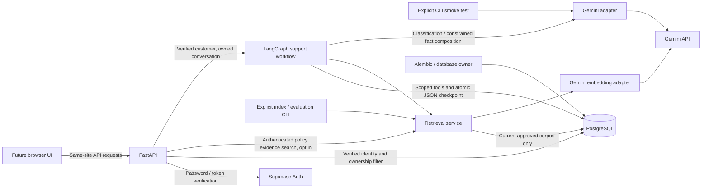

# Backend architecture — Phases 1–4

The browser has no direct database access. Supabase returns authoritative identity and app_metadata;
the backend maps that verified Auth UUID to a customer. Order queries always include the customer ID.
Support and administrator access is separate from customer endpoints; neither role can impersonate a
customer through the customer API.

Application SQL connections use the fixed `service_role`; migration connections retain the owner role.
PostgreSQL RLS is enabled and forced without browser policies. Direct grants to `anon`, `authenticated`,
and `PUBLIC` are revoked. Since the backend role bypasses RLS, backend authorization is mandatory.

Credentials are read from backend-only environment variables. Sensitive configuration fields have masked
representations. Auth tokens are HttpOnly cookies; login responses contain no tokens. Untrusted-origin
mutations are rejected, provider errors are generalized, validation errors omit raw input, and SQL
parameters are hidden in database errors. Request IDs contain no customer information.

Gemini has no database credentials or automatic tool execution. The chat adapter serves explicit CLI
checks and the opt-in support graph. The separate embedding adapter serves explicit policy indexing/evaluation
and opt-in authenticated policy search. Startup, health checks, seed commands, and
Auth/order/refund/escalation routes make no Gemini requests.
There is no offline pretend-AI fallback. Missing keys and provider failures are explicit failures.

The development SQLite fallback tests application behavior but cannot prove PostgreSQL access restrictions.
A dedicated PostgreSQL integration test checks the actual role and RLS configuration. Both that test
and real local Supabase/Auth verification have passed. Gemini's synthetic live smoke test has also passed.

## Local development environment

The minimal project-specific Supabase stack runs PostgreSQL 15, GoTrue Auth, PostgREST, and the API
gateway. The local connection URLs use ports 54331 and 54332 through the `canopy-ai-local` Docker network.
The backend runs separately on `127.0.0.1:8000`. Existing Docker projects use their own containers/ports.
Studio, mail testing, storage, analytics, Realtime, and edge functions are disabled until needed.
Alembic owns application migrations; the Python seed owns synthetic business records.

`python -m canopy.local_setup --start` starts/configures the local stack without printing keys or
passwords. It preserves the Gemini configuration, writes database/Auth settings atomically, creates
confirmed synthetic Auth accounts, links them by UUID, and performs real session/authorization checks.
Account passwords are kept in ignored `backend/.env.demo`; no actual customer data is used.

## Hosted development environment

The maintainer's active backend connects to a hosted development Supabase project in `eu-west-1`
under a verified Free organization. No paid plan was activated. Public clones configure their own project.
The SQL connection uses the Supabase session pooler on port 5432 with TLS; the runtime still switches
to `service_role`, while Alembic runs as the owner. Authentication uses the project's HTTPS Auth API.
Migrations, synthetic business records, and five confirmed test Auth accounts have been provisioned.
Real hosted Auth sessions, cross-customer denial, role restrictions, direct PostgREST denial, and forced
PostgreSQL RLS have been verified. No email was sent during synthetic account provisioning.

`backend/.env` holds the active server-only connection settings. `backend/.env.supabase-local` is a
restricted, ignored backup of the local settings. Machine-specific project identity is in ignored `supabase/cloud.json`.
Restart the API after switching environments. The product frontend and backend hosting are still deferred.

## Foundation limits to address in later phases

- The login rate limiter is process-local; shared rate limiting is required before release.
- Supabase Auth is verified per request. Session refresh is an explicit endpoint; browser coordination
  will be implemented with the UI.
- Logout requests refresh-session revocation; already-issued access JWTs may remain valid until expiry.
- Refund lifecycle transitions and reservation release remain deferred. Submitted requests are simulated.
- Markdown policy ingestion and vector retrieval are implemented; uploads, conversation memory,
  agent traces, and chat-model workflow evaluation remain deferred.
- Future traces must transmit sanitized summaries/metadata rather than raw customer messages or graph state.

## Phase 2 business operations

Authenticated HTTP routes call `SupportTools`; future graph nodes can use the same operations after
receiving backend-verified identity. The pure policy evaluator accepts database facts and a clock,
returns structured reasons, and has no LLM dependency. Eligibility checks are read-only.

Refund submission locks the owned order, checks idempotency again after acquiring the lock, evaluates
current policy, then atomically reserves item quantities and order value. Conditional updates and check
constraints bound reservations. Composite foreign keys bind requests to their order/customer and lines
to the same order. The request, its line allocations, and sanitized audit event commit together; failures
roll back the reservations. Replaying a customer-scoped key returns its existing request. Changed payloads
conflict, and concurrent fresh keys still cannot reserve excess quantities.

Escalation creation verifies order/conversation ownership, marks the conversation escalated, and writes
an audit event in the same transaction. Support/admin routes manage assignment and forward status
transitions. Conversation locks serialize ticket updates before determining whether open work remains.
Refund review routes are read-only. No endpoint transfers money or marks a refund completed.

Migration `0003` extends the existing eleven tables and adds `refund_lines` and `audit_events`, both
with forced RLS and no client grants. Legacy active requests conservatively reserve whole orders,
without fabricating confirmation timestamps or item allocations.

## Phase 3 policy evidence

Migration `0004` extends `policy_documents` and adds `policy_chunks` with `vector(768)` and a frozen
embedding-space constraint. pgvector can live in `public` or Supabase's `extensions` schema. Connection
search paths are fixed to those two schemas; runtime still switches to `service_role`, while migrations
retain owner identity. Chunk DML grants are backend-only; RLS is enabled and forced without client policies.

The packaged manifest pins Markdown file hashes, source versions, rules version, and chunker version.
Indexing preserves complete sections and atomically publishes the full corpus, serialized by a PostgreSQL
advisory transaction lock. Identical sources are skipped without provider calls; immutable source/version
conflicts are refused. Failed provider batches leave no partial publication. Explicit rerun recovers
missing/incomplete chunks from approved source bytes.

Retrieval validates current source identities and exact sections against the packaged corpus before
query embedding. pgvector exact cosine candidates are reranked with an IDF-weighted keyword overlap
bonus; a semantic floor and meaningful policy-term overlap govern admission. Results contain exact
excerpts and stable source/version/hash/section citations, never generated policy or refund decisions.
Missing evidence or conflicting current sources yield explicit human-review states with no citations.
Historical sources do not compete with the current corpus. SQLite's JSON/vector arithmetic is only
the explicit development/test fallback. See `phase-3-review.md` for boundaries and measured evaluation.

## Phase 4 support turns

The graph holds backend-verified customer/actor identity in code, never accepts identity from graph/model
fields, and validates current ownership before touching memory or business records. Classification
extracts intent and optional order/policy search context. Order and policy reads use separate sessions
when concurrent. Structured response generation selects trusted fact IDs; rendering preserves required
facts and exact cited excerpts. Unsupported or conflicting evidence remains explicit.

Explicit item selections produce 15-minute refund quotes. A separate structured confirmation action
must reference an owned active quote with exact current policy and amount. The deterministic tool
rechecks eligibility and reservations. Quote consumption, simulated request, audit, messages, checkpoint,
execution, and replay result commit together. PostgreSQL advisory locks reject overlapping turns;
same-key retries replay committed results. Changed instructions invalidate pending previews.

The custom JSON-only LangGraph saver stages worker writes and commits the latest END snapshot from
the coordinating session. Persistence is at turn boundaries; no mid-node resume or time travel is
promised. Failed/disconnected uncommitted turns roll back and can rerun safely. SSE publishes fixed
progress events and validated committed text, never raw provider tokens or checkpoint state.

Automatic LangSmith callbacks are disabled even under inherited tracing settings. Manual optional
export builds a new metadata allowlist without customer/thread/order identifiers or raw text. Internal
execution records retain observed usage, completeness, latency, versioned chat-cost estimates, and safe
error categories. External delivery remains unverified until a LangSmith key is configured. See
`phase-4-review.md` for contracts, model/pricing references, evaluation results, and recovery limits.
